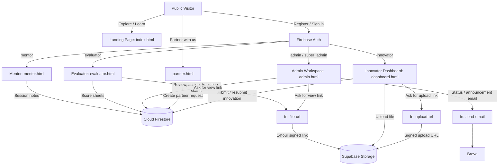

# DICON Grassroots Innovations Talent Hunt (GITH)

[](#)
[](#)
[](#)
[](#)

A digital platform powered by the **Defence Industries Corporation of Nigeria (DICON)** to discover, evaluate, mentor, and accelerate indigenous grassroots technological and industrial innovations.

---

## 📌 Table of Contents

- [Overview](#overview)
- [Key Features](#key-features)
- [Application Architecture](#application-architecture)
- [Project Structure](#project-structure)
- [Getting Started](#getting-started)
  - [Prerequisites](#prerequisites)
  - [Local run and tests](#local-run-and-tests)
- [Configuration](#configuration)
- [User Roles & Portals](#user-roles--portals)
- [Security & Rules](#security--rules)
- [Deployment](#deployment)

---

## 🌟 Overview

The **DICON Grassroots Innovations Talent Hunt (GITH)** is an initiative aimed at tapping into Nigeria's creative and inventive talent pool. This platform bridges inventors, technicians, and local creators directly with defence, industrial, and national technology ecosystems through a transparent, multi-stage submission, vetting, and incubation pipeline.

---

## ✨ Key Features

### 🏛️ Editorial & Public Landing Portal
- **Modern Institutional UI**: Tailored with institutional colors (Deep Emerald & Gold) and crisp typography.
- **Program Roadmap & Guidelines**: Clear eligibility criteria, submission stages, and interactive FAQ sections.
- **Deep-Linked Portals**: Direct routing into Innovator Registration, Login, and Status Inquiries.

### 🚀 Innovator Experience
- **Multi-Step Innovation Submission Engine**: Guided 7-step form (including the support you are looking for) with live validation, client-side draft auto-saving, and IP declaration.
- **Real-Time Application Tracking**: Visual milestone timeline reflecting current evaluation stages (*Screening &rarr; Verification &rarr; Assessment &rarr; Shortlisted &rarr; Selected &rarr; Mentorship &rarr; Incubation*).
- **Profile & Skill Management**: Dynamic profile completion score calculation and inventor asset management.
- **Notification Center**: In-app notifications alerting inventors on status updates, feedback, and milestone changes.

### 🤝 Sponsors & Partners
- **Partner With Us page (`/partner`)**: companies, foundations and institutions say what they can offer (funding, mentorship, manufacturing, equipment, market access, training…), which innovation categories and states interest them (or "All categories" / "Nationwide"), and how they can be reached.
- **Admin follow-up**: requests appear under **Partner Requests** in the admin dashboard with a new-request badge, filters by category / state / status, a detail drawer, a status pipeline (*New → Contacted → In discussion → Partnered / Declined*) and private internal notes.
- Stored in the `partnerRequests` Firestore collection: the public can create a request but can never read or change one; only admins can.

### 🛡️ Administrative Command Center
- **Role-Based Access Control (RBAC)**: Secure access restricted to verified administrative staff.
- **Live Pipeline Analytics**: Real-time metrics tracking submissions, reviewed items, and category distributions.
- **Application Review Workflow**: Detailed submission inspector, status transitions, evaluation notes, and accessible toast/modal notifications.

---

## 🏗️ Application Architecture



Firestore is the source of truth; the Firestore rules decide who can read and write what. Files live in
Supabase Storage (no Firebase Blaze plan needed); the serverless functions (Netlify or Vercel) hold the Supabase and Brevo keys
and check the caller's Firebase sign-in before doing anything.

---

## 📂 Project Structure

```text
├── *.html                      # One page per portal: index, about, login, register, forgot-password,
│                               #   dashboard, admin, evaluator, mentor, partner, showcase, admin-guide, ...
├── assets/                     # Logo, imagery, background video
├── css/                        # styles.css (tokens/components), dashboard.css, landing.css, motion.css, ...
├── js/
│   ├── firebase-config.js      # Firebase client init (+ App Check) and the few raw Firestore writes
│   ├── auth-service.js         # Sign-in, registration, role checks
│   ├── storage.js              # Data layer: innovations, drafts, notifications, Firestore sync
│   ├── dashboard-app.js        # Innovator dashboard (profile, tracking, notifications)
│   ├── dashboard-wizard.js     #   └ 7-step submission wizard, drafts, resubmission (mixed in)
│   ├── admin-app.js            # Admin workspace (review queue, status transitions, audit, analytics)
│   ├── admin-matching.js       #   ├ sponsor matching (mixed in)
│   ├── admin-partners.js       #   ├ partner requests (mixed in)
│   ├── admin-policy.js         #   └ policy / content editor (mixed in)
│   ├── admin-phase2.js         # Evaluation workspace (assignments, results, events, roles)
│   ├── evaluator-app.js, mentor-app.js, partner-page.js
│   ├── phase2-service.js, matching-service.js, partner-service.js, legal-content.js
│   ├── file-upload.js          # Upload to Supabase via upload-url; signed view links via file-url
│   ├── file-viewer.js          # Attachment list + lightbox (only http(s)/inline-media links are shown)
│   ├── mixin.js                # Copies a section class's methods onto a page controller
│   └── data.js                 # Categories, states, pipeline stages
├── netlify/functions/          # Netlify entry points (wrap api/_lib/)
├── docs/                       # Admin Guide, Cost Note, Approval Pack (PDF is linked publicly; .md is not served)
├── seed/                       # Reference data + seed script
├── tests/                      # node --test suites
├── firestore.rules             # Firestore security rules (the real access control)
├── storage.rules               # Legacy Firebase Storage rules (Storage is no longer used; files are on Supabase)
├── server.js                   # Zero-dependency local server (also used by the Dockerfile)
├── api/                        # Vercel functions; api/_lib/ holds the shared function code
├── netlify.toml, _redirects, _headers   # Netlify hosting
└── vercel.json, .vercelignore, firebase.json   # Alternative hosts
```

The admin and innovator controllers are split by section: each section is a class in its own file whose
methods are copied onto the controller by `mixin()` (see `js/mixin.js`), so `this` is shared as before.

---

## 🚀 Getting Started

### Prerequisites

- [Node.js](https://nodejs.org/) 18 or later (22 recommended). There are no npm dependencies.
- Modern web browser (Chrome, Edge, Firefox, or Safari)
- Optional: [Firebase CLI](https://firebase.google.com/docs/cli) (`npm install -g firebase-tools`) to deploy rules

### Local run and tests

```bash
npm start        # http://localhost:3000
npm test         # runs tests/*.test.mjs
```

On `localhost` the app can run in a browser-only "local mode" for trying it out; on a real domain it
requires Firebase (see `SECURITY.md`).

---

## 🔑 Configuration

- **Firebase:** web config in [js/firebase-config.js](js/firebase-config.js). Enable Email/Password and Google
  sign-in, create Firestore, and add your domain under Authentication → Authorized domains. Restrict the
  browser API key to your domains (see `SECURITY.md`).
- **File storage:** Supabase buckets and host environment variables, including the required bucket
  size/type limits: see [SUPABASE_SETUP.md](SUPABASE_SETUP.md).
- **Email:** Brevo keys in the host settings: see [BACKUP_AND_ALERTS.md](BACKUP_AND_ALERTS.md) and `.env.example`.
- **App Check:** see [APP_CHECK_SETUP.md](APP_CHECK_SETUP.md).

---

## 👥 User Roles & Portals

| Route | Who | What |
|---|---|---|
| `/` | Public | Programme overview, eligibility, announcements |
| `/register`, `/login` | Everyone | Registration (always `innovator`), sign-in routed by role |
| `/partner` | Sponsors & companies | "Partner with us" form |
| `/showcase` | Public | Admin-curated innovations (with the innovator's consent) |
| `/dashboard` | Innovators | Submission wizard, drafts, tracking, corrections and resubmission |
| `/evaluator` | Evaluators | Assigned innovations only; 6-criterion score sheet |
| `/mentor` | Mentors | Assigned mentees only; private session notes |
| `/admin` | Admins / super admins | Review queue, evaluation workspace, partners, matching, content, audit log |

---

## 🔒 Security & Rules

- **Firestore rules (`firestore.rules`)** are the access control:
  - Innovators read and write only their own records, and only the fields the submission form sends.
    A submitted innovation must carry a reference number reserved for it in `referenceNumbers`.
  - Evaluators and mentors read only innovations an admin assigned to them; score sheets are shape- and
    range-checked and lock once submitted.
  - Only a `super_admin` changes roles or edits another admin; nobody changes their own role or email.
  - `partnerRequests`: anyone may *create* a strictly validated request; only admins can read or change them.
- **Files:** private bucket; view links are signed for one hour and only for the owner, admins, and
  evaluators/mentors who can read the innovation. Upload limits are enforced by the Supabase bucket settings.
- See [SECURITY.md](SECURITY.md) for the steps that must be done in the consoles.

---

## 🌐 Deployment

The three server functions (`upload-url`, `file-url`, `send-email`) are written once in `api/_lib/` and run on
both Netlify and Vercel. The browser always calls `/.netlify/functions/<name>`; on Vercel, `vercel.json`
rewrites that to `/api/<name>`.

**Vercel:** import the repo (Framework preset: *Other*, no build command; `vercel.json` sets the output to the
site root). Each file in `api/` becomes a function; `api/_lib/` is shared code, not a function. Add the
variables from `.env.example` under Project → Settings → Environment Variables (Production), then redeploy.

**Netlify:** connect the repo; `netlify.toml` publishes the site root and the functions in `netlify/functions`
(thin wrappers around `api/_lib/`). Private files are blocked by `_redirects` (a test checks every private file
is listed). Set the variables from `.env.example` under Site configuration → Environment variables.

**Either host, before launch:**
- Firestore rules, after any change to `firestore.rules`:
  ```bash
  firebase deploy --only firestore:rules
  ```
- Add the site's domain to Firebase Authentication → Authorized domains, to the Firebase browser API key's
  website restrictions, and to the reCAPTCHA (App Check) key's domains.
- Set the Supabase bucket limits ([SUPABASE_SETUP.md](SUPABASE_SETUP.md), step 1.3).

Firebase Hosting (`firebase.json`) and Docker (`Dockerfile`, runs `server.js`) serve the pages only; uploads,
private file links and emails need Netlify or Vercel.

---

## 📄 License

This software and related documentation are proprietary to the **Defence Industries Corporation of Nigeria (DICON)**. All rights reserved.

---

## Phase 2 (evaluation) — added

- `/evaluator` — evaluator workspace (assignments, read-only review, 6-criterion score sheet, draft/submit-and-lock).
- Admin → **Evaluation Workspace**: assign evaluators (min 2), results & ranking, shortlist/select, verification notes, events, announcements, roles and scoring weights.
- Innovator dashboard shows published events as **Upcoming Opportunities**.
- New collections: `assignments`, `assessments`, `events`, `verifications` (admin-only). Redeploy rules: `firebase deploy --only firestore:rules`.
- App Check: set `APP_CHECK_SITE_KEY` in `js/firebase-config.js` after registering reCAPTCHA v3 in Firebase console.
- Email: status-change and announcement emails are sent by the `send-email` function (`api/_lib/send-email.js`) via Brevo (see BACKUP_AND_ALERTS.md).

## Phase 3 — added
- **Motion:** `css/motion.css` + `js/motion.js` on every page: liquid blobs that follow finger/mouse/phone tilt, tap ripples, scroll reveals, animated sign-up steps. Respects "reduce motion".
- **Google sign-in** on login/register (enable the Google provider in Firebase -> Authentication). New Google users are always `innovator`.
- **Conflict-of-interest** warnings when assigning evaluators/mentors (same person, state or organisation).
- **Showcase** (`/showcase`): admin-curated public page; needs the consent box ticked. Rules enforce it.
- **Mentors** (`/mentor`): mentor role, assigned mentees, private session notes.
- **Analytics:** anonymous Google Analytics 4, loads only after the visitor accepts the banner.
- Redeploy rules: `firebase deploy --only firestore:rules`.
